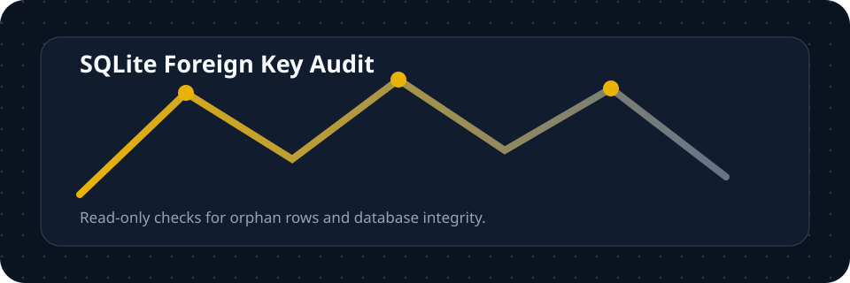

<div align="center">


[](LICENSE)



</div>

## :compass: Overview

A read-only SQLite database checker that runs foreign_key_check and integrity_check, then presents orphan references and database integrity results as a concise report.

## :sparkles: Features

- :white_check_mark: Opens databases in read-only mode
- :white_check_mark: Finds rows that violate declared foreign keys
- :white_check_mark: Runs SQLite integrity_check
- :white_check_mark: Supports readable and JSON reports

## :clapper: Demo

```bash
python main.py examples/shop.db --json
```

The example runs locally; no hosted service or upload is required.

## :rocket: Quick Start

```bash
python -m pip install -r requirements.txt
python main.py --help
```

## :toolbox: Tech Stack

- Python 3.10+ standard library (sqlite3)
- Automated tests: unittest with temporary in-memory databases
- Local-first processing

## :file_folder: Folder Structure

```text
sqlite-fk-audit/\n├── main.py\n├── requirements.txt\n├── tests/test_core.py\n├── examples/README.md\n└── assets/illustration.svg
```

## :world_map: Roadmap

- [x] Core workflow
- [x] Example input and tests
- [ ] Additional report formats
- [ ] Continuous integration on supported platforms

## :handshake: Contributing

Issues and pull requests are welcome. Keep changes focused, document behavior changes, and add tests for new features.

## :page_facing_up: License

MIT - see [LICENSE](LICENSE).

<div align="center"></div>
